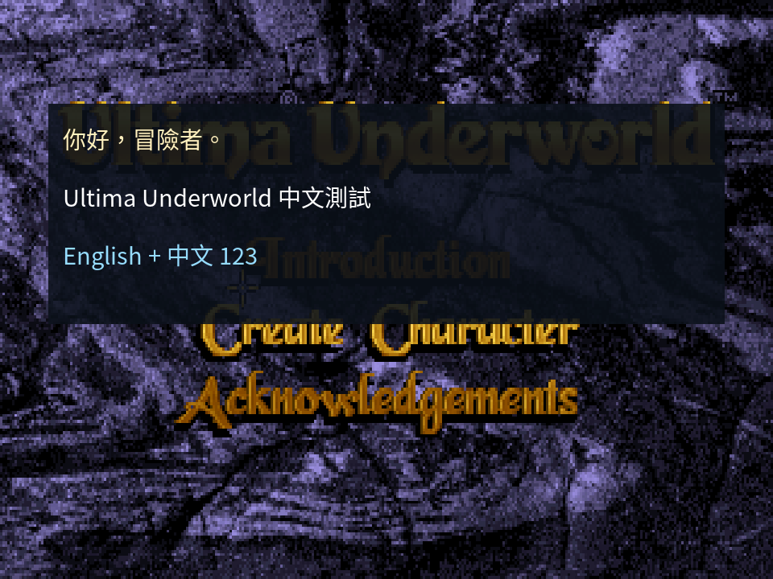

# Phase 5 — FreeType HD Text

## Status

**PASS — Native Acceptance Gate P5，2026-10-21。**
Windows 實際視窗／遊戲示範與 renderer sanitizer 通過，Windows／Linux／macOS 的 Native
compile/link 與實際 FreeType CJK renderer tests 均通過；Web 以無 FreeType fallback 成功編譯。
本階段仍依 [Native-only 規則](VALIDATION.md)，沒有 DOS／Borland gate。
只有獨立文字示範；未將譯文接入 conversation、未取代原游標，也未開始 Phase 6。

## Baseline

| 項目 | Phase 開始版本 |
| --- | --- |
| Underworld upstream/main | `e5deadd6945b492636aadccc14f52caa908b4186` |
| Underworld feature | `2963fb5c868a5687bca1b58b96e6713101395ec7` |
| Exhume upstream/master | `c54e00e9176c14d0913b5806318a30f85a8f4636` |
| Exhume overlay pin | `89278495bb0b8b224b5bb58e53da2fd367c0d8c0` |

本階段不需修改 Exhume。所有 font/layout policy、demo 與 tests 均在 UW1。

## Renderer contract

[hd_font.h](../../src/port/presentation/hd_font.h) 提供 opaque `HdFont`、init/shutdown、
native/logical measure 與 logical-coordinate draw；header 不暴露 SDL 或 FreeType types。
Font、cache 及所有呼叫均由 presentation thread 擁有；main 在啟動前建立，`plat_run` 返回後釋放。
Web browser loop 未返回時不提早釋放；無 FreeType build 使用明確 `HD_UNAVAILABLE` stub。
demo 只讀固定文字與 callback geometry，不接觸 game-thread mutable strings。

每個 `HdFont` owns 一個 scalable Unicode face。Cache key 為 face ownership、pixel size、Unicode
codepoint 與 render mode；目前只實作 `FT_RENDER_MODE_NORMAL` grayscale。512 entries / 8 MiB bitmap
雙重上限，LRU eviction，glyph mask owns copy，不保留 FreeType 可變 glyph-slot 指標。
Stats 可觀察 hit/miss/rasterization/eviction/missing glyph；不存在的字以 U+FFFD 或 `.notdef` 呈現。

使用 Phase 3 UTF-8 validator / layout，整數 26.6 advances、中文標點禁則與 logical wrapping。
使用 backend float viewport，X/Y scale 分開；font ppem 按 logical em × Y scale 四捨五入，範圍 1–256。
文字 glyph 在 output 保持自然比例；native width / X scale、native height / Y scale 得到 logical metrics。
重新設定輸出尺寸時，按新 ppem 直接從 outline 產生 mask，既有大小則從 cache 取用。
沒有把 glyph 寫進或放大 320×200 framebuffer。

Baseline 使用 face ascender；多行依 face line height，metrics 是 advance bounds，不是 ink bounding box。
Native wrap width 上限 1,000,000 pixels；非正值使用 `INT_MAX` 26.6 layout 上限，並非無限長行。
Draw 以 clipped、straight-alpha source-over 合成到 RGBA，支援已有透明背景的 layer。
UTF-8 不合法、NUL、無效 geometry 會在畫 pixel 前拒絕。PoC 不做 kerning、shaping、完整 grapheme 或
game control execution；控制碼仍是 zero-width units。

FreeType 行為參考官方 [glyph slot/render](https://freetype.org/freetype2/docs/reference/ft2-glyph_retrieval.html)
與 [bitmap pitch/gray](https://freetype.org/freetype2/docs/reference/ft2-basic_types.html#ft_bitmap)。

## Font / License

- Font：**Noto Sans CJK TC Regular**，Version 2.004，OTF/CFF。
- Copyright metadata：© 2014–2021 Adobe (http://www.adobe.com/)。
- Source：[notofonts/noto-cjk](https://github.com/notofonts/noto-cjk)，commit `f8d157532fbfaeda587e826d4cd5b21a49186f7c`，
  `Sans/OTF/TraditionalChinese/NotoSansCJKtc-Regular.otf`。
- Font SHA-256：`dce08bd4fd91aa8aa76ed8fea4b694c2dfb8550f67871e326843212ddbeb88b4`。
- License：SIL Open Font License 1.1，原文見 [Noto-OFL.txt](licenses/Noto-OFL.txt)。
  原檔下載／cache／顯示，不修改或 subset，也不將 font binary 提交 repository。
  可以與軟體一起散布，須保留 copyright / license，不能單獨出售字型；衍生版本須遵守 OFL 命名與授權條件。
  這裡只散布 fetch tool 與 renderer；目前未製作新的 release package。

[fetch_font.py](../../tools/i18n/fetch_font.py) 固定 commit 與兩份檔案 SHA-256，
同時下載 font 與授權至 ignored `tools/fonts/`。參見官方 [OFL text](https://raw.githubusercontent.com/notofonts/noto-cjk/main/Sans/LICENSE)。

FreeType 使用 FreeType License（FTL），見 [FTL.txt](licenses/FTL.txt)。本機測試版本 2.14.3，
官方 tag `VER-2-14-3`；獨立 source build 關閉 HarfBuzz/Brotli/BZip2/PNG/zlib optional deps。
This software uses the FreeType project. Copyright © 1996–2026 The FreeType Project.
FreeType source/binary 未提交；若之後製作套件，須包含相應 library 與 license。

## Build / Validation

依 [README](../../i18n/README.md) 安裝 development package、下載 font、建置與執行 `--test-hd-text`。
三句示範：`你好，冒險者。`、`Ultima Underworld 中文測試`、`English + 中文 123`。
無 FreeType 或字型無法載入時，明示 opt-in 會輸出診斷並返回非零；原英文路徑仍可建置執行。

`test_hd_font.py` 將真實 renderer、Phase 3 core 與 PNG writer 編譯成 standalone C executable，
不需遊戲 assets。測量、glyph cache、AA、alpha over existing layer、malformed UTF-8、不改寫失敗 output、
wrapping、不同 font instance / size、800 個 CJK glyphs 的 LRU 壓力、pitch padding 與 guard bytes 都有 assertions。
`--sanitize` 以 ASan/UBSan 重跑；`--window` 復用 Exhume generic fixture，通過真實 SDL backend compositor。

### 本輪驗證

| 測試 | 結果 |
| --- | --- |
| Windows Native build | PASS，89 game C + 98 port C；新增 renderer 無 warning，既有 mt32roms unused-variable warning |
| Windows port-check | PASS，89 C compile，0 errors / 0 warnings |
| FreeType standalone renderer | PASS，4,411,580 assertions（主要為逐像素比較，不是四百萬組不同 cases） |
| Renderer coverage | 三句 CJK/ASCII、灰階 AA、native/logical metrics、logical anchor 平移、透明／半透明文字及已有 alpha layer |
| Cache | warm draw 不增加 rasterizations；size／face 分開、800 CJK glyphs eviction、512 entries / 8 MiB bounds |
| Errors / memory | malformed UTF-8、NUL、NaN、oversized ppem、missing glyph fallback、空文字、窄欄換行、pitch padding / guards |
| ASan + UBSan | PASS，完整 standalone assertions + 6 組實際 SDL window scenarios；Windows 無 LeakSanitizer |
| SDL window integration | PASS，window resize、fractional letterbox、aspect on/off、integer/free、fullscreen／return |
| Window ppem / reuse | 19 → 21 → 16 → 21 → 72 → 19；32 → 64 → 96 → 96 → 128 → 128 rasterizations |
| Actual UW1 demo | PASS，960×720、640×400、2880×1800 screenshots；已目視檢查 windowed / fullscreen |
| Optional dependency | PASS，無 FreeType macro 的 stub 單獨 compile/link/run；明示 `HD_UNAVAILABLE`，metrics 不改寫 |
| Bad font path | PASS，Native opt-in 清楚診斷並 exit 1 |
| Prior text core/runtime/inventory | PASS，29 + 16 + 22 = 67 tests |
| English Native replay | PASS，16 sessions / 1,786 checkpoints，saves 相同 |
| zh-TW lookup Native replay | PASS，16 sessions / 1,786 checkpoints，12 個命中與 TSV 相同 |
| Native decoder / hook | PASS，10,984 strings + 2 missing keys，block 0、dynamic、ring lifetime |

Actual game window 的 32/64 rasterizations 包含啟動時 scanout mode / ppem 的不同；
約 14k–22k cache hits，沒有每 frame 重新 rasterize。固定 viewport 的 frame reuse 有直接 assertions。
不沿用 P4 matrix 的次數當成本輪結果；P5 沒有修改 backend/gameplay，廣泛 UI/movement/fuzz matrix
為 P4 歷史證據，本輪聚焦字型專項、雙 locale replay 與既有文字核心。

### 跨平台 CI

[uw1-port run 39623506142](https://github.com/pmanyeh/underworld-exhumed/actions/runs/39623506142)
對應 code/test commit `55db77f62e17a7d9ebff020036da95e149737dc9`，**四個 jobs 全部 success**：

| 平台 | 驗證 |
| --- | --- |
| Ubuntu 24.04 x64 | 完整 Native compile/link、89 game C compile、FreeType CJK renderer assertions |
| macOS 15 Intel | 完整 Native compile/link、89 game C compile、FreeType CJK renderer assertions |
| Windows hosted / MSYS2 CLANG64 | 完整 Native compile/link、89 game C compile、FreeType CJK renderer assertions |
| Web / Emscripten | 完整 web compile/link；FreeType disabled stub，不宣稱已做 Web HD rendering |

三個 Native jobs 都核對同一 Noto font / license SHA-256，並通過 4,411,580 assertions。
Linux / macOS 的 game-only port-check 各有 46 個既有 warnings、0 errors；game sources 未變更。
Renderer test 使用 `-Wall -Wextra -Werror`，不可將「job success」解讀為全部 game C 零 warning。
CI 不含原版 assets，不在 Linux/macOS 執行整個遊戲；這兩個平台的真實 OS window / fullscreen
仍未實測。CI 所執行的是完整編譯連結與 standalone 實際 font rasterization，符合 P5 非主要平台驗收範圍。

首次 `c45c5a1` CI 抓到 Linux 缺少獨立 `floor`/libm link；`06def21` 改成 bounded integer rounding，
不引入 OS shortcut。該提交的 CI 與上述最終 CI 均成功。P4 的 macOS job 先前因 ARM hosted
capacity 未取得 runner 而取消，本輪改用支援的 `macos-15-intel` 並完成驗證。

### Evidence / images

完整 hashes、log 清單與已知限制見 [manifest](evidence/p5/manifest.json)，
CI source / jobs 見 [CI evidence](evidence/p5/ci.json)。

[Fullscreen](evidence/p5/hd-fullscreen.png)、[square-pixel window](evidence/p5/hd-free.png)、
[fractional resize fixture](evidence/p5/resize.png)、[standalone RGBA glyphs](evidence/p5/font.png)。
圖片只做 lossless PNG compression，沒有把中文事後貼到截圖，也沒有修改遊戲 assets。

## Limits / local environment

Windows 的實際 view/render/screenshot 已驗證。實體多螢幕 DPI 拖移尚未測試；output/window 比例由 P4
synthetic targets 與本輪 viewport measurements 驗證。只支援 basic CJK additive layout；無 shaping、kerning、
彩色字型、垂直排版、完整 grapheme/UAX14；本輪沒有承諾 conversation 翻譯已上畫面。
Sanitizer 涵蓋本專案 renderer / layout 與 backend fixture；第三方 FreeType/SDL DLL 本身未以 sanitizer 重編。
未製作新的 release package，因此不宣稱現有 packaging 已包含 FreeType / font；本輪是可建置、可執行的 Native PoC。

本機 portable pacman 安裝時留下 database lock，清除鎖檔的操作被自動安全審查拒絕；未改用其他方式刪除。
改從官方 FreeType tag 原始碼獨立建置並安裝到 ignored `tools/libs`，測試與 Native launcher 使用該 library。
tarball SHA-256：`dc49de6b01a266eef4876a4dd34d9842c475d3e28ff2eff63bd2fb760ab56261`。
鎖檔留在工作區外層 `.poc-tools/msys64/var/lib/pacman/db.lck`；本輪建置不依賴它。
DOS validation：**NOT APPLICABLE — Native-only PoC**。

## Git / Sync Gate

實作 `c45c5a1`，portable rounding 修正 `06def21`，最終 renderer tests `55db77f` 已 push。
本輪報告與 evidence 提交後，在 clean working tree 執行 Phase boundary fetch，結果另記錄於本節。
