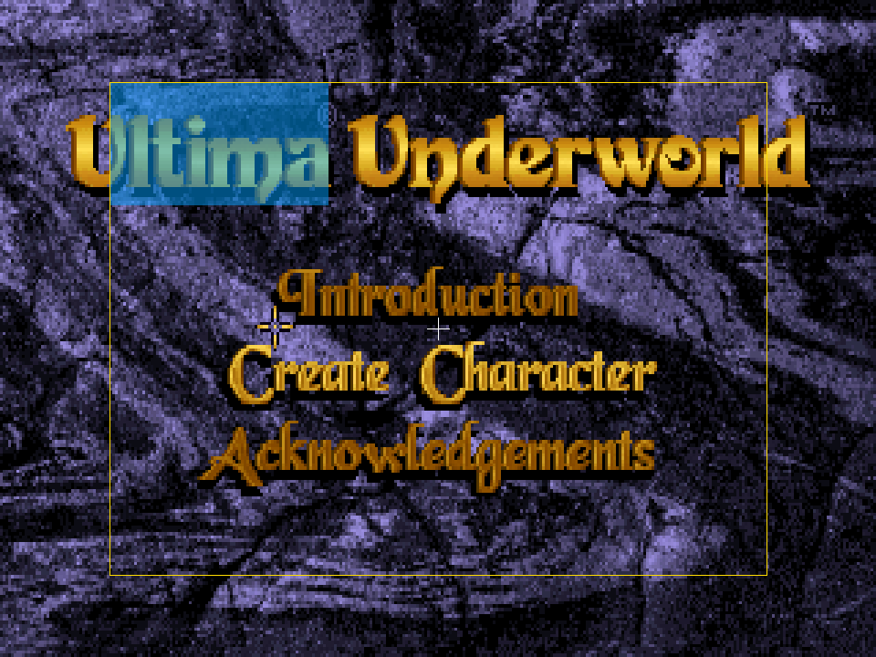

# Phase 4 — Generic HD Overlay Foundation

## Result

**PASS — Native Acceptance Gate P4，2026-10-21。**

已完成 Exhume 通用、選用的 native-output RGBA presentation layer，及 UW1 的 opt-in 幾何示範。
沒有加入 FreeType、中文字型、中文渲染或 HD cursor；下一階段尚未開始。
依 [Native-only 規則](VALIDATION.md) 驗收；沒有執行 DOS／Borland 或重新生成 goldens。

## Baseline / Platform

| 項目 | Phase 開始時的版本 |
| --- | --- |
| Underworld upstream/main | `e5deadd6945b492636aadccc14f52caa908b4186` |
| Underworld feature | `1adbb73176120c1a4c106787262574d83a3eb71b` |
| Exhume upstream/master | `c54e00e9176c14d0913b5806318a30f85a8f4636` |
| Exhume current pin / feature baseline | `a34316463c230bafa3d4f0aa3b894a574e5fc738` |
| OS / compiler / SDL3 / Python | Windows / MSYS2 CLANG64 Clang 23.1.3 / 3.4.18 / 3.12.10 |
| FreeType | 未使用或加入 dependency |

開始時工作樹 clean，Underworld origin/upstream 與 Exhume upstream fetch 後沒有新更新。
建立 [pmanyeh/Exhume](https://github.com/pmanyeh/Exhume) fork 的 `feature/presentation-overlay`，
由既有已驗證 pin 開始。`main` mirror 對應 upstream/master；既有七個 tooling/profile backlog commits
沒有在本階段中途併入 feature。最終 pin、提交與同步結果見本報告的 Git / Sync Gate。

## Changes / Contract

Exhume 只包含 `PlatOverlay`／callback contract、SDL3 合成與 generic tests/docs。
其內沒有 UW-specific lookup、locale、Bragit、FreeType policy 或 game UI geometry。
UW1 的 [overlay_demo.c](../../src/port/presentation/overlay_demo.c) 與
[main.c](../../src/port/sys/main.c) 綁定 `--test-overlay`，預設不啟用。

| 合成順序 | 座標與行為 |
| --- | --- |
| Clear | renderer output 清為黑色 |
| Game | indexed scanout 轉成 game texture，按既有 viewport 呈現 |
| Presentation overlay | 整個 native renderer output 的 RGBA32 texture；straight alpha |
| Settings | dim game destination，再畫既有 settings layer；明示位於 overlay 上方 |
| Capture / Present | window-shot 包含 overlay；indexed scanout screenshot 維持原路徑 |

`plat.h` 不含 SDL type。Callback 收到 backend-owned、每 frame 清為透明的 R/G/B/A bytes，
含 width/height/pitch、window points、scanout logical dimensions 與精確 float viewport。
尺寸使用 renderer output pixels，與 window coordinates 分開，避免 HiDPI 誤用。
logical `(x,y)` 映到 `viewport.xy + (x,y) * viewport.wh / logical.wh`；caller 決定 raster rounding。
buffer 可畫 letterbox；demo 只以 viewport 建立框、色塊與準星。

資源僅在有 callback 的呈現路徑配置，output size 變更時重建，結束時銷毀。
配置／texture setup 失敗保留遊戲、記錄一次錯誤，下一次尺寸變更重試。
hidden／minimized／無 renderer／零尺寸路徑不呼叫。Callback 回傳零即不合成，透明內容等同未註冊。
沒有 hook 的原有呈現路徑維持相同。沒有修改 gameplay、存檔、replay inputs 或 goldens。

descriptor 與 buffer 只在 callback 期間有效，不可保留或交給 game thread。
callback、allocation、texture update／destroy 均在 presentation thread。
demo 只用 callback metadata，不讀寫 game state，因此沒有新跨執行緒共享資料；
未來文字 commands 必須先 publish immutable snapshot 或同步，API 不提供自動同步保證。

SDL 契約依官方 [output size](https://wiki.libsdl.org/SDL3/SDL_GetCurrentRenderOutputSize)、
[pixel format](https://wiki.libsdl.org/SDL3/SDL_PixelFormat) 與
[texture blending](https://wiki.libsdl.org/SDL3/SDL_SetTextureBlendMode) 文件。

## Tests / Evidence

執行命令與使用方式見 [README](../../i18n/README.md)。
本輪 logs、hashes 與統計見 [manifest](evidence/p4/manifest.json)。

| 測試 | 結果 |
| --- | --- |
| Standalone Exhume backend | PASS，hidden case + 26 composition scenarios；`-Wall -Wextra -Werror` |
| ASan + UBSan backend harness | PASS，同一 hidden / 26 scenarios；Windows 無 LeakSanitizer |
| Physical pixel / alpha | opaque、half-alpha、透明、return-zero、one-output-pixel line 與 per-frame clear assertions |
| Geometry | aspect on/off、integer on/off、downscale、fractional letterbox、320×200 → 640×480 scanout change |
| Output / window | software outputs 960×720、1001×733、240×150、1600×1200；window points 固定 400×300 |
| Actual host renderer | 640×480／853×517 resize、fullscreen、回到 windowed；Windows D3D11 |
| Z-order | synthetic opaque settings fixture 蓋過 overlay；另執行真實 settings regression |
| UW1 / UW2 Native builds | PASS，89+96 / 99+94 game+port sources；既有 mt32roms unused-variable warning |
| UW1 Native port-check | PASS，89 C sources，0 errors / 0 warnings |
| English replay | PASS，16 sessions / 1,786 checkpoints，含 saves |
| zh-TW lookup replay | PASS，16 sessions / 1,786 checkpoints，12 個譯文命中與 TSV 相同 |
| Native decoder / hook | PASS，10,984 entries + 2 missing keys，block 0 / dynamic / ring lifetime |
| Native routine fuzz | PASS，34 routines / 5,680 cases，0 differ |
| Enhancements / movement / blackbox / map notes | PASS，120 / 15 / 22 / 4 checks |
| Settings | 72 distinct checks 經原 assertions 驗證；首次 70/72，兩個 timing cases 單獨重跑通過 |

Settings 初次在並行矩陣中 `wclick` 與 `lostup` 失敗。保留原始非零 exit code、70/72 log；
個別重跑兩個 cases 共 5 assertions 全數通過，其中 2 個補足失敗、3 個是重複驗證，
不計為 77 個 distinct checks。沒有修改 product code、原 test inputs 或 assertions 來取得通過。
這兩個 UI timing cases 在本輪有不穩定性，不能宣稱首次全綠。
Windows test host 使用既有 `-pthread` fuzz link workaround；settings scratch path 將 `:` 改為 `_`，
wrapper 也套用於子程序，原有測試內容保留。可重現 wrapper 見 evidence。

### 實際示範畫面

白色準星與黃色框為 native-output pixels；藍色色塊為 alpha 128。
兩種 locale 關閉 overlay 的 window-shot，分別與同一 frame 的原始 scanout nearest scaling **逐像素相同**。
示範畫面的框、單像素準星及色塊 alpha 另有像素 assertions。
選單 logo 會循環變色，因此不同執行的固定秒數截圖不能要求相同 palette；
不以此 wall-clock 差異判定 locale regression。相同來源 frame 的 off／transparent／return-zero
完整像素相等由 standalone harness 驗證，遊戲狀態另由雙 locale replay 驗證。

## Validation Limits

Windows 已實測；Linux、macOS、Web 未編譯／執行。Web 使用相同 SDL3 path，hidden no-renderer 會跳過，
新 API 沒有 Emscripten 專用 dependency；這是程式設計上的相容性，不視為 Web 實測結果。
HiDPI output/window 座標差由合成 targets 驗證，尚未實測不同 DPI 實體螢幕間拖移。
Sanitizer 涵蓋實際 backend + synthetic callbacks，不能擴大聲稱整個遊戲已通過 sanitizer。
UW2 編譯成功，但本機僅有 UW1 assets，UW2 runtime/replay 未執行；不宣稱兩款遊戲完整 test-full。
DOS validation 為 **NOT APPLICABLE — Native-only PoC**。

## Git / Sync Gate

Exhume feature commit：`89278495bb0b8b224b5bb58e53da2fd367c0d8c0`。
已先 push 到 fork，再更新主專案 `.gitmodules` URL/pin，讓新 clone 能取得該 commit。
Phase 4 的最終 SHAs、clean-boundary fetch 與標籤將於結案同步紀錄填入。
