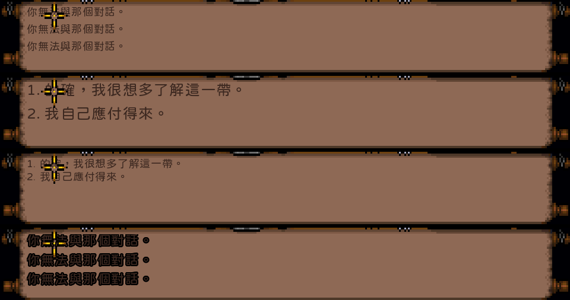

# P10T — 中文文字顯示參數設定

**結果：PASS。** 高解析中文字的字型、字級、字距、中英間距、行距、基線、黑框、反鋸齒與缺字備用字型，
都可以用設定檔調整；設定名稱與 Ultima VIII 中文化的 `scummvm.ini` 相同。預設字型改為 jf open 粉圓 2.1，
其餘預設值維持 P10A 的效果。設定介面依計畫留到之後（P12／M1）。

| 項目 | 值 |
| --- | --- |
| 日期 | 2026-10-23 |
| 依據 | v2.5 計畫 P10.9（P10T）；使用者決定：名稱沿用 U8、預設粉圓體、預設值沿用目前效果 |
| 玩家說明 | [SETTINGS.zh-TW.md](../../i18n/zh-TW/SETTINGS.zh-TW.md) |
| 繁中預設設定檔 | [text-settings.ini](../../i18n/zh-TW/text-settings.ini) |
| 證據 | [evidence/p10t/](evidence/p10t/)（數字摘要、腳本、只含中文的截圖對照） |

## A. 設定

| 設定 | 預設 | 範圍 | 影響 |
| --- | --- | --- | --- |
| `font_cjk_hd_file` | `jf-openhuninn-2.1.ttf` | | 排版＋繪製 |
| `font_cjk_hd_fallback_file` | （無） | | 排版＋繪製 |
| `font_cjk_hd_size` | `5` | 2～16 | 排版＋繪製 |
| `font_cjk_hd_letter_spacing` | `0` | -2～8 | 排版 |
| `font_cjk_hd_latin_spacing` | `0` | -2～8 | 排版 |
| `font_cjk_hd_line_spacing` | `0` | -3～16 | 排版（加在遊戲的行高 8 上） |
| `font_cjk_hd_baseline` | `0` | -4～4 | 只有繪製 |
| `font_cjk_hd_border` | `0` | 0～2 | 只有繪製 |
| `font_cjk_hd_antialiasing` | `true` | | 只有繪製 |

- 單位是遊戲像素（畫面寬 320），可以有小數；排版以 1/64 精度計算，行距的小數也保留。
- **類別：** `font_cjk_<類別>_<項目>` 覆寫單一類別。`message`＝下方訊息捲軸（UW1 對話時的玩家選項也在這裡），
  `talk`＝對話時 NPC 的文字框，`book`＝書本與卷軸（P10C／P12 接上前沒有作用）。
- **優先順序（計畫要求）：** 命令列 `--font` > 玩家的 `uw1port.cfg` > `i18n/<locale>/text-settings.ini` > 程式內建。
  每個檔案裡先套用 `font_cjk_hd_`，再套用類別自己的設定。locale 預設檔不寫死 zh-TW，以 `--locale` 決定路徑。
- **安全：** 檔案缺漏沿用前一層；數值無法解讀或超出範圍時，記錄中說明並沿用前一層的值，不會中止。
  找不到主字型時明確報錯結束（不悄悄改用其他字型）；找不到備用字型時說明並不使用。所有文字仍裁切在原本的 box 內。
- 啟動時在記錄中列出兩個 box 實際採用的字型與數值，以及讀到的 locale 設定檔，供回報問題時判斷。
- 玩家設定檔沿用 port 既有的 `uw1port.cfg`：設定畫面（F11）寫入時只替換它自己的那一行，中文設定與註解都會保留。
  locale 預設檔用 `.ini`，因為 repo 規則禁止提交 `.cfg`（防止誤提交遊戲的 `UW.CFG`）。

## B. 程式修改

| 檔案 | 內容 |
| --- | --- |
| `src/port/presentation/text_style.{c,h}` | 新增：讀設定檔、範圍檢查、字型搜尋（home 的 `fonts/`、`fonts/`、`tools/fonts/`）、locale 預設檔位置 |
| `src/port/i18n/layout.{c,h}` | 新增 `layout_text_spaced`（字距、中英間距在換行前計入）與 `layout_latin_boundary`；原函式行為不變 |
| `src/port/presentation/scroll_text.{c,h}` | 每個 box 的樣式與量測 context；行距以 1/64 精度（新欄位 `line64`、`y64`、`em64`，原整數欄位照舊）；跨兩次輸出的中英交界補上間距 |
| `src/port/presentation/hd_font.{c,h}` | 反鋸齒開關、黑框繪製（`hd_scroll_glyph_border`）、缺字備用字型（量測與繪製一致） |
| `src/port/presentation/scroll_overlay.{c,h}`、`presentation.{c,h}` | 每個 box 各自的字型、黑框、基線 |
| `src/port/sys/main.c` | 依優先順序讀設定；遊戲執行緒與畫面執行緒各自開字型（相同時共用）；預設不再寫死 Noto |
| `tools/i18n/fetch_font.py` | 加入 jf open 粉圓 2.1（官方 release，SHA-256 與 U8 1.0.3 使用的檔案相同）與其授權 |

遊戲本身的 C（`SCROLLIO.C` 等）與翻譯後的組合語言都沒有修改；英文模式（未啟用 HD scroll）不讀這些設定。

## C. 驗證

| 檢查 | 結果 |
| --- | --- |
| `test_text_style.py`（新，不需遊戲資料；含 ASan＋UBSan） | PASS，36 個斷言：預設值、每個設定、類別覆寫、檔案優先順序、不合法值與範圍、字型搜尋、locale 檔 |
| `test_layout.py` | OK，36 個測試（新增 7 個：字距、中英交界、控制碼、換行寬度、0 間距等同原函式、負值下限） |
| `test_scroll_text.py`（含 `--sanitize`） | PASS（新增 styles：行距位置、行數、選項點擊、字距、跨輸出的中英間距、各 box 獨立） |
| `test_scroll_text.py --render` | PASS，73,232 個斷言（新增黑框、基線、反鋸齒、em、備用字型） |
| `test_hd_font.py`、`test_hd_cursor.py`、`verify_layout_sanitizers.py` | PASS（測試字型改為預設的粉圓體） |
| `test_l10n.py` | OK |
| `verify_localized_replay.py` | PASS，16 個 session，35 個翻譯命中與 master 相同 |
| 全部公開 session 對 DOS golden（英文） | 全部相同 |
| P10.11 存檔比對（en、zh-TW、zh-TW＋HD 預設、zh-TW＋HD 非預設參數） | 11 個存檔 session 四種模式全部相同，見 [P10_11_SAVE_CHECK.md](P10_11_SAVE_CHECK.md) |
| 大字參數（字級 7、行距 +3）重播 5 個存檔 session | `tooheavy`、`overpay` 各多一次 [MORE]，存檔仍與預設 HD 相同 |

**截圖（計畫要求的三組參數＋綜合）：** 實際開視窗、以輸入腳本與 Bragit 對話，四組設定的 log 都列出了正確的字型與數值。
提交的對照圖只裁下方訊息捲軸（只含中文）：由上而下為預設、大字（7／+3）、窄行距（-2）、綜合（字級 6、字距 0.4、中英間距 1、行距 1、黑框 0.5）。
完整截圖（對話框含原版英文的模板句）只留在本機 `build/i18n/p10t/visual/`。

## D. Findings

- **T1（預期行為）：** 字級、行距會改變每頁行數，因此改變 [MORE] 的出現時機；HD 排版結果又會寫回遊戲記憶體（P10A F1）。
  所以 HD 錄影除了與 catalog 綁定，也與文字參數綁定。存檔不受影響（上表）；HD 錄影規則目前暫停，恢復時須固定使用錄製時的參數。
- **T2（測試方法）：** 以輸入腳本即時操作的截圖不具確定性：同一設定連跑兩次，一次進入對話、一次 80 次右鍵交談都落空，
  與參數無關（P10A 已見過）。確定性的驗證一律用重播；截圖只作為視覺確認。
- **T3（字型涵蓋）：** jf open 粉圓 2.1 約 12,000 字，涵蓋目前 master 與 Authority 的全部 1,267 個非 ASCII 字元。
  P10B 大量翻譯後應再檢查；若有缺字，可設定 `font_cjk_hd_fallback_file`（例如 Noto Sans CJK TC）。建議把這項檢查加入每批的流程。
- **T4（UW1 版面）：** UW1 的玩家選項顯示在下方訊息捲軸，不在對話框，所以選項跟著 `message` 的設定，與 U8 不同；已寫入玩家說明。
- 計畫列為選用的「顏色調整」未做，文字顏色沿用遊戲調色盤。

## E. 尚未做（依計畫）

設定介面、即時預覽、書本／UI 的實際接線（P12／M1）。`book` 類別名稱已保留。
