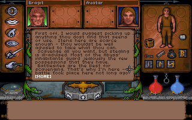

# Phase 0 Report — Native Baseline / Fork Pre-flight

## Result

**BLOCKED — 原生基線可用，但 DOS exact-match gate 尚未通過。**

日期：2026-10-21（Asia/Taipei）。依工作區計劃 v2.1 的 Phase 0 執行。
本輪只建立與驗證 upstream baseline，未新增中文化、FreeType、overlay 或 gameplay 修改。

Windows 原生建置、獨立啟動、16 組 native replay 均成功。使用者確認目前沒有
Turbo C++ 1.01 / TASM 2.0；本機也尚未完成 Exhume DOS 執行環境設定。
`make check` 因此無法完成物件檔與 exact link 比對。這是未完成的驗收，不能以 native replay 的成功替代。

## Baseline

| 項目 | SHA |
| --- | --- |
| Underworld upstream/main | `e5deadd6945b492636aadccc14f52caa908b4186` |
| Underworld feature/zh-tw-native（本輪受測原始碼） | `e5deadd6945b492636aadccc14f52caa908b4186` |
| Exhume upstream baseline（Underworld 指定的 submodule） | `a34316463c230bafa3d4f0aa3b894a574e5fc738` |
| Exhume feature baseline | `a34316463c230bafa3d4f0aa3b894a574e5fc738`；未建立 overlay feature，沿用未修改的 upstream pin |
| Exhume origin/master（preflight 與結束時觀察到的 upstream 最新版本） | `c54e00e9176c14d0913b5806318a30f85a8f4636` |

報告與證據 commit 會使 feature branch 前進；上述 feature SHA 指實際建置與測試的程式碼版本。
後續 commit 只有本報告與驗證證據。未變更 submodule pointer。

## Platform

| 項目 | 實際環境 |
| --- | --- |
| OS | Windows 11 Pro x64，10.0.26200 / build 26200 |
| Native compiler | MSYS2 CLANG64 clang 23.1.3，`x86_64-w64-windows-gnu` |
| SDL3 | 3.4.18 |
| Python | 3.12.10，工作區隔離 venv |
| Python dependencies | iced-x86 1.21.0、unicorn 2.1.4、Pillow 13.0.0 |
| Sound | Nuked OPL3；與 upstream Windows port CI 相同，未連結 libmt32emu |
| FreeType | Phase 0 未使用 |

工具安裝在工作區的 `.poc-tools/`，不在 Git 倉庫內，未變更系統 PATH。
MSYS2 base 使用官方 2026-09-27 archive，SHA-256：
`ea2f31a0b6ade63914ce441ffb022f0f6aa96982bfefa2326460a26d5fb01322`，
與 [官方 release asset digest](https://github.com/msys2/msys2-installer/releases/tag/2026-09-27) 相符。

## Changes

- 重用既有 `pmanyeh/underworld-exhumed` fork，設定 `upstream`。
- 在開始 Phase 0 驗證前，將落後 13 commits 的 fork/main 以 fast-forward 同步至 upstream。
- 從同步後的 main 建立 `feature/zh-tw-native`，初始化 recursive submodule。
- 將兩個新 clone 的本機 `core.autocrlf` 設為 false，依 index 重新 checkout LF 內容；Git 內容無差異。
- 建立隔離的 Windows 編譯工具與 Python 環境，編譯 UW1 native executable。
- 從使用者提供的 GOG `game.gog`，以 7-Zip 僅解出 `UW/` 到 Git 外的 `.poc-private/game/UW`。
- 原始 `UW.EXE` MD5：`8afc3c29ef5667a3ab6667e8cbc8d63a`，符合 `exhume.toml` 記載的 GOG 版本。
- 遊戲資料、工具鏈、執行檔、save 與原始 replay state dump 均未加入 Git。
- 工作區外層另附 `Start-UW1-PoC.ps1`，以獨立 player home 啟動已編譯的原生程式。

## Files changed

- 本報告：`uw1/docs/i18n/PREFLIGHT.md`。
- 驗證 logs、CI metadata、checkpoint metadata 與五張基線截圖：`uw1/docs/i18n/evidence/`。
- 遊戲原始碼、Exhume、generated source、build scripts 與 CI workflow：無修改。

## Commands run

主要 Git 流程：

```sh
git clone --recursive https://github.com/pmanyeh/underworld-exhumed.git
git remote add upstream https://github.com/abedegno/underworld-exhumed.git
git fetch upstream
git merge --ff-only upstream/main
git push origin main
git switch -c feature/zh-tw-native
git submodule update --init --recursive
```

從 MSYS2 CLANG64 shell，在 `uw1/` 下執行：

```sh
sh ../exhume/tools/setup-sound.sh tools/nuked-opl3
make PY=../../.poc-tools/python/Scripts/python.exe port
make PY=../../.poc-tools/python/Scripts/python.exe port-check
```

原生回歸：

```sh
python ../exhume/tools/replay.py --config build/poc/replay.toml verify all -j 4
```

此命令使用 `UW1DECOMP` 指向 `uw1/`，`UW1_DATA` 指向解出的合法遊戲資料，
`UW1_EXE` 指向其中的 `UW.EXE`；native DLL 目錄放入該程序的 PATH。

**Windows staging 調整：** 此帳號建立 symlink 會回傳 WinError 1314。
暫存的 `build/poc/replay.toml` 複製原設定，只將 `data_skip` 改為 `[]`。
先確認本輪解出的資料目錄沒有 `SAVE1`–`SAVE4`，因此不需再略過既有 saves，
且可避免 upstream staging 的 symlink 需求。所有受測遊戲程式、recordings、goldens、比較規則皆維持原樣。
這份暫存設定在 ignored build 目錄，未改動 `exhume.toml`。

獨立啟動測試使用 absolute paths：

```sh
uw1port.exe --data <workspace>/.poc-private/game/UW --home <workspace>/.poc-private/smoke-home --hidden --no-audio --screenshot-after 3000 --screenshot <workspace>/.poc-evidence/native-title.png --exit-after 4000
```

exact-match gate（在 CLANG64 shell 補上既有 Node.js 的 PATH 後執行）：

```sh
make PY=../../.poc-tools/python/Scripts/python.exe check
```

## Tests

| 項目 | 結果 / 證據 |
| --- | --- |
| Windows native build | **PASS**；89 個 game sources、92 個 port sources，成功 link 5,101,568-byte executable；[build log](evidence/windows-build.log) |
| Compile-only port-check | **PASS**；上述同一命令鏈 exit 0；log 包含 upstream 的 unresolved/category 分析，並非 link failure |
| 不執行 DOSBox 的 native launch | **PASS**；hidden SDL scanout 執行 4 秒，exit 0 並產生截圖；[launch log](evidence/native-launch.log) |
| legal data | **PASS**；由使用者提供的 GOG image 解出，EXE fingerprint 符合，native 讀取成功 |
| newgame / 進入 3D | **PASS**；41 checkpoints 與 DOS golden 相同 |
| walk | **PASS**；66 checkpoints 相同 |
| items / save / load | **PASS**；items 100、load 17 checkpoints；存檔內容相同 |
| Bragit 多輪英文對話 | **PASS**；talk 的 627 checkpoints 相同 |
| mouse / cursor 自動回歸 | **PASS**；walk、items、talk、savecursor 覆蓋移動、點擊、物品持取、游標狀態；savecursor 79 checkpoints 與 saves 相同 |
| 全部 native replay | **PASS**；16 sessions、1,786 checkpoints，所有 golden state 與適用的 saves 相同；[完整 log](evidence/native-replay-verify.log) |
| make repocheck | **PASS**；新增報告後的來源語法、Markdown 連結與禁止散布檔案檢查通過；[log](evidence/repocheck.log)。CLANG64 shell 使用 `MSYS2_PATH_TYPE=inherit` 以取得既有 Git / Node.js |
| 現場視窗中的人工 mouse move / click / drag 驗收 | **未驗證**；本輪是自動 replay 與 hidden scanout，仍需人工互動確認 |
| make check / DOS exact-match | **BLOCKED / 命令 exit 2**；143 sources 均未取得待比對物件，exact link 未產生；[gate log](evidence/make-check.log) |
| make test | **未執行完整套件**；必要的 make check 已失敗，依 P0 停止規則保留阻礙；未宣稱完整測試通過 |

`verify` 嘗試重建 replay DOS build 時也未取得物件檔，因此跳過 golden 與該次 DOS build hash 的 freshness 檢查。
它仍確實執行全部 native sessions，逐 checkpoint 比對**倉庫既有** DOS goldens。
本輪未重新產生 DOS goldens，亦未證明 exact-match build。

Native executable SHA-256：
`b0042f92818ead32c32c86fd132c9ba6d3fe19204b6dd762e079c2da45e47d9d`。

## Cross-platform

同一受測 SHA `e5deadd...` 的 [fork baseline CI run](https://github.com/pmanyeh/underworld-exhumed/actions/runs/39553234590)
已完成；[留存 metadata](evidence/upstream-baseline-ci.json)。

| 平台 | 結果 |
| --- | --- |
| Windows | 本機 native build / port-check / replay PASS；baseline CI build PASS |
| macOS | 同一 baseline SHA 的 CI build / port-check PASS；未在本機執行 |
| Linux | 同一 baseline SHA 的 CI build / port-check PASS；未在本機執行 DOS gate |
| Web | 同一 baseline SHA 的 CI web build PASS；本輪沒有修改 Web API |

這是 upstream 原始碼的基線證據，並非未來 zh-TW 功能的跨平台驗收。

## Screenshots / Evidence

以下圖片取自**本機 native replay 的 STATE.OUT**，使用 upstream `replay.py` 的
`read_dump` / `scanout` / `write_png` 匯出，沒有複製 golden PNG 當成新執行結果。
[checkpoint metadata](evidence/checkpoints.json) 記錄 session、索引、事件數與遊戲時鐘。
這些是 Phase 0 的 320×200 英文基線，尚非 HD 中文成果。

| 圖片 | 證明範圍 |
| --- | --- |
| [Native title](evidence/native-title.png) | 獨立原生啟動的 scanout screenshot |
| [New game / 3D world](evidence/newgame-ck0040.png) | native 新角色與地下城畫面 |
| [Item on cursor](evidence/savecursor-ck0060.png) | 物品持取時的游標及原版操作限制 |
| [Bragit / player choices](evidence/talk-ck0550.png) | 已到 Bragit，玩家有三個回應選項 |
| [Bragit / later dialogue](evidence/talk-ck0626.png) | 同次多輪對話的後續段落與 MORE 提示 |




原始 replay dumps 留在本機 `uw1/build/replay/verify/`，包含遊戲狀態，不提交 Git。

## Regressions

16 組 native replay 未觀察到與既有 DOS goldens 的差異。DOS exact-match 與完整 make test 未獲驗證。
原生 build 的 upstream warnings 保留在 log，本輪沒有為消除警告而修改來源。

另外觀察到：將 `--data` 直接指定到只含 `game.gog` 的 GOG 安裝父目錄會啟動失敗，
雖然 help 宣稱可以接受該種路徑。[probe log](evidence/gog-parent-folder-probe.log) 保存失敗結果。
檢視 `main.c` 後確認 explicit `--data` 直接傳入檔案層，未走 `port_game_in` 搜尋；
本輪以解出後、實際含 UW.EXE 的 `UW/` 作為正確資料路徑完成啟動，沒有修補 upstream。

## Git / Branch State

| 項目 | 狀態 |
| --- | --- |
| Current branch | `feature/zh-tw-native` |
| origin | `https://github.com/pmanyeh/underworld-exhumed.git` |
| upstream | `https://github.com/abedegno/underworld-exhumed.git` |
| main / origin/main / upstream/main | 均為 `e5deadd6945b492636aadccc14f52caa908b4186` |
| Feature branch 起點 | 與上述 main 相同；無中文化 commit |
| Exhume submodule | `a34316463c230bafa3d4f0aa3b894a574e5fc738`，detached HEAD、未修改 |
| Working tree | 驗證前 clean；本輪新增內容限本報告與 evidence，commit 後 clean |
| Tags | P0 未 PASS，因此沒有建立 PASS milestone tag |

## Upstream Sync Gate

- 已在本輪驗證與報告階段邊界 fetch Underworld upstream 與 Exhume origin。
- Underworld：相對 preflight baseline **NO CHANGE**，feature source 與 upstream/main ahead/behind `0 / 0`。
- Exhume：相對本輪初次觀察到的 origin/master **NO CHANGE**。
- Exhume origin/master 原本就比 Underworld 指定 pin 多 7 commits，為 tooling / profiles / skills 與 merge commits；不是本輪中途出現的 runtime 更新。
- 未 merge 此 backlog，維持 Underworld 經 upstream 指定的 runtime pin。沒有 submodule reconciliation，也沒有 mid-phase merge。
- P0 gate BLOCKED，未執行 feature upstream merge，無 merge 後回歸項目。

## Blockers / Risks

1. **缺少 Turbo C++ 1.01 / TASM 2.0。** 使用者已確認目前沒有；未下載或散布未授權工具。
2. **DOS gate 環境尚未就緒。** 初次 CLANG64 shell 未包含 Node.js PATH；補上既有 Node 後 gate 仍無物件檔產出。
   Exhume 的 Node dependencies / DOS backend 也尚未完整 setup，故不能把 `0/143` 解讀成 143 個實際二進位碼不符。
3. **仍需人工互動驗收。** 已證明 recorded input / cursor states 與 DOS 相同，但未以真實滑鼠在可見視窗逐項驗收。
4. 本機 Windows port 未連結 libmt32emu；soundmt replay 的 state comparison 不等於 MT-32 音訊品質驗證。

## Recommended next step

取得合法工具鏈後，依 [共用建置文件](../../../docs/BUILDING.md) 與
[UW1 建置文件](../BUILDING.md) 完成 DOS gate 環境，設定 `UW1_EXE` / `UW1_DATA`，
重跑 `make check`，通過後再跑完整 `make test`。在可見 native 視窗補做滑鼠 move / click / drag / cursor switching。

本機可由工作區外層執行 `./Start-UW1-PoC.ps1` 開啟目前的英文 native baseline；
它使用 `.poc-private/player-home/` 儲存新 save，不寫入 GOG 安裝目錄。
P0 全部驗收通過後，才進入 Phase 1 text inventory。

**STOPPED HERE. Phase 1 was not started.**
