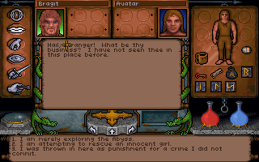

# Phase 0 Report — Native Baseline / Fork Pre-flight

目前依 [使用者更新的 Native-only 規則](VALIDATION.md)，不要求 Borland / DOS 驗收。
以下 DOS deferred / NOT RUN 為本階段當時的歷史紀錄，不再列為待解決事項。

## Result

依工作區計劃 **v2.2** 重新驗收，日期：2026-10-21（Asia/Taipei）。

| 驗收 | 結果 |
| --- | --- |
| Native Build | **PASS** — MSYS2 CLANG64 / Clang，含 libmt32emu |
| Native Runtime | **PASS** — 原生啟動、3D、新角色、Bragit、mouse/cursor、save/load 與 Native/public 測試 |
| DOS Exact-Match | **NOT RUN / DEFERRED** — 本輪未執行 make check |
| Overall Phase 0 | **PASS（Native gate）** |

```text
DOS_EXACT_MATCH_CHECK:
NOT RUN — Borland reference toolchain not installed
```

v2.2 將 Borland reference toolchain 從 Native PoC 前置條件移除。
本輪沒有尋找、安裝或執行 Turbo C++ / TASM，未新增中文化或 HD 功能。
[v2.1 歷史報告](PREFLIGHT-v2.1.md) 與其 gate 失敗紀錄保留；該輪的 BLOCKED 判定不沿用為 v2.2 的 Native blocker。

**測試結果的界線：** 初次 Native test tier 的程序 exit 1，原因為 Windows 測試工具的 pthread 連結與暫存目錄命名問題。
本輪保留原始 log，修正測試工具的執行環境後，只補跑受影響項目，均通過。
下表是完整 Native 元件矩陣的合併驗收結果；未宣稱未修改的 upstream `make test` 整個 target 回傳成功。

## Baseline

| 項目 | SHA / 狀態 |
| --- | --- |
| Underworld upstream/main | `e5deadd6945b492636aadccc14f52caa908b4186` |
| Underworld feature/zh-tw-native（本輪受測 checkout） | `569e36f7a3670deb82d6ae59699a997b1d0c588f` |
| Exhume upstream baseline / submodule pin | `a34316463c230bafa3d4f0aa3b894a574e5fc738` |
| Exhume feature baseline | `a34316463c230bafa3d4f0aa3b894a574e5fc738`；尚未建立 overlay feature，使用未修改的 upstream pin |
| Exhume origin/master（phase 開始時觀察） | `c54e00e9176c14d0913b5806318a30f85a8f4636` |

受測 feature checkout 與 upstream 的差異只有先前的報告和 evidence。
本次新增內容也限文件與 evidence；遊戲、Exhume、build scripts、CI workflows、generated source 與 submodule pointer 均未變更。
本報告之後的文件 commit 不改變受測程式碼。

## Platform

| 項目 | 實際環境 |
| --- | --- |
| OS | Windows 11 Pro x64，10.0.26200 |
| Native compiler | MSYS2 CLANG64 clang 23.1.3，`x86_64-w64-windows-gnu` |
| SDL3 | 3.4.18 |
| libmt32emu | 2.8.3，upstream setup-port recipe 指定的版本 |
| OPL | Nuked OPL3，upstream pin `765ec96` |
| Python | 工作區 venv，3.12.10；iced-x86 1.21.0、unicorn 2.1.4、Pillow 13.0.0 |
| FreeType | 未使用；不在 Phase 0 範圍 |
| Borland reference toolchain | 未正確安裝；已有壓縮檔不等於可用的 TC / TASM / DOS reference 環境 |

## Changes / Files changed

- 依 v2.2 重新執行完整 upstream `setup-port`，補裝 CMake / Ninja 等依賴並建置 libmt32emu。
- 使用既有 `feature/zh-tw-native`；main 維持 upstream mirror，沒有 rebase、force push 或 mid-phase merge。
- 本報告取代 v2.1 的現行結論，原報告另存為 `PREFLIGHT-v2.1.md`。
- 新證據在 `uw1/docs/i18n/evidence/v2.2/`；舊證據完整保留。
- 工作區外層 `Start-UW1-PoC.ps1` 增加本機 `tools/libs/bin` 的程序 PATH，讓新 executable 找到 MT-32 DLL；已實際測試啟動。
- 遊戲資料沿用使用者 GOG image 解出的 `.poc-private/game/UW/`，存檔與設定使用隔離 home，未加入 Git。
- 沒有修改 runtime C、gameplay、Exhume source、翻譯資料或 generated source。

## Commands run

主要 upstream 命令：

```sh
make GAME=uw1 setup-port
make GAME=uw1 PY=../../.poc-tools/python/Scripts/python.exe port
make -C uw1 PY=../../.poc-tools/python/Scripts/python.exe port-check
```

CLANG64 shell 使用 `MSYS2_PATH_TYPE=inherit` 取得本機 Git / Node.js。
Windows 路徑含空白時，upstream `portbuild.py` 的 pkg-config 輸出以 `.split()` 解析，會拆開路徑。
完整 setup-port 裝好 libmt32emu 後暴露此問題，最初 build 失敗的原始紀錄見
[setup / initial build](evidence/v2.2/v22-native-setup-build.log) 與
[dependency alias probe](evidence/v2.2/v22-native-build.log)。

本輪使用本機 NTFS junction 作為**建置環境別名**：

| 別名 | 實際目錄 |
| --- | --- |
| `D:/git/uw1-native-poc` | 工作區 `D:/git/Ultima Underworld` |
| `D:/git/uw1-poc-libs` | `underworld-exhumed/uw1/tools/libs` |

以 upstream generator 在無空白 dependency prefix 重新產生安裝設定，再從 workspace alias 建置。
未手改 generated `.pc`，也未將 Windows API 或 workaround 塞進遊戲來源。

```sh
SETUP_LIBS=mt32emu sh exhume/tools/setup-libs.sh /d/git/uw1-poc-libs
export UW1DECOMP=D:/git/uw1-native-poc/underworld-exhumed/uw1
cd /d/git/uw1-native-poc/underworld-exhumed
make GAME=uw1 PY=../../.poc-tools/python/Scripts/python.exe port
make -C uw1 PY=../../.poc-tools/python/Scripts/python.exe port-check
```

Native/public tests 沿用 upstream `test.py`：

```sh
cd /d/git/uw1-native-poc/underworld-exhumed/uw1
export UW1_DATA=D:/git/uw1-native-poc/.poc-private/game/UW
export UW1_EXE=$UW1_DATA/UW.EXE
export PATH="$PWD/tools/libs/bin:$PATH"
../../.poc-tools/python/Scripts/python.exe ../../.poc-tools/prepare-native-v22.py
../../.poc-tools/python/Scripts/python.exe ../exhume/tools/test.py --config build/poc/native-v22.toml native
```

[準備腳本快照](evidence/v2.2/prepare-native-v22.py.txt) 記錄設定產生方式。
暫存設定僅在 ignored `build/poc/`：從 upstream `test.fast` 複製八個 Native steps 為 `test.native`，
只排除 `the gate`（DOS reference）；原本 `test.fast` / `test.full` 保持原樣。
因抽出的資料沒有 SAVE1–SAVE4，將暫存設定的 `data_skip` 設為 `[]`，避免本機無 symlink 權限的 staging 問題。
遊戲輸入、goldens、比較規則與 Native assertions 都維持 upstream。

## Tests

### Native — Mandatory

| 項目 | 最終結果 / 證據 |
| --- | --- |
| setup-port | **PASS**；完整 recipe 執行成功，依賴路徑問題已以環境別名處理 |
| Native build / port-check | **PASS**；89 game sources、92 port sources，linked 5,108,224-byte executable，Nuked OPL3 + libmt32emu；[成功 log](evidence/v2.2/v22-native-build-no-space.log) |
| Native launch / local launcher | **PASS**；隔離 home、無 DOSBox，實際執行並產生 screenshot，exit 0；[log](evidence/v2.2/v22-native-launch.log) |
| legal data | **PASS**；使用者 GOG `UW.EXE` MD5 `8afc3c29ef5667a3ab6667e8cbc8d63a`，native 讀取成功 |
| 全部 public native replay | **PASS**；16 sessions、1,786 checkpoints 與既有 DOS goldens 相同，適用的 saves 相同 |
| new game / 3D world | **PASS**；newgame 的 41 checkpoints 相同 |
| Bragit | **PASS**；talk 的 627 checkpoints 相同，多輪對話與回應選擇可達 |
| mouse / cursor / items / save-load | **PASS**；walk、items、talk、savecursor、load 的 recorded mouse / button / item / save state 比對相同；設定測試另驗證 SDL window click、held-button 與 resize 後座標 |
| Differential fuzz | **PASS after host-link repair**；34 routines、5,680 cases、0 differ；[補測 log](evidence/v2.2/v22-native-fuzz.log) |
| Enhancements | **PASS**；120/120 checks |
| Settings screen | **PASS after scratch-path repair**；初次 68 checks 通過，受影響切片補跑 8/8；去除重複後共 72 個不同 assertions 通過；[補測 log](evidence/v2.2/v22-settings-roundtrip.log) |
| Player movement | **PASS**；15/15，包括五個朝向下的側移 / 後退與 frame pacing |
| Session black box | **PASS**；22/22，包括 recording retention、stage content 與 fault 後記錄完整性 |
| Map notes | **PASS**；4/4，原生程式在測試構造的無 terminator note 下完成地圖切換，無 host fault |
| make repocheck | **PASS**；文件連結、來源語法與禁止散布檔案檢查通過；[log](evidence/v2.2/repocheck.log) |

[完整初次 Native tier log](evidence/v2.2/v22-native-public-tests.log) 保留所有輸出與其 exit-1 summary。
不是將兩個錯誤刪掉或忽略：只重跑受影響項目後，才以上列合併矩陣判定 Native gate PASS。

兩項 Windows 測試工具處理如下：

1. **fuzzhost 缺少 `-pthread`。** 正式 port link 本來有此參數，但 upstream fuzzhost link 未帶入。
   使用同一批 upstream 產生的 object，加上相同 thread link flag 重連結測試 host，並補上 Windows `.exe` 的 cache 路徑，
   然後原樣執行 `fuzzasm.py` 的全部 5,680 cases。未更動 routines 或 expected results。
   [執行腳本快照](evidence/v2.2/prepare-fuzzhost-link.py.txt)。
2. **Settings slice 的 `rt-4:3_aspect` 不是合法 Windows 目錄名。** 初次是建立 scratch directory 的 exception，沒有執行到後續 assertions。
   在補測 wrapper 中，只將傳入 `fresh()` 的暫存目錄名稱冒號換為底線，重跑原始 `roundtrip:1/3`。
   UI labels、導航輸入、預期設定值、screenshots 與 assertions 都未更動，8/8 通過。
   [wrapper 快照](evidence/v2.2/setcheck-safe-tempnames.py.txt)。

### DOS Exact-Match — Optional / Deferred

Toolchain available: **NO**。

```text
DOS_EXACT_MATCH_CHECK:
NOT RUN — Borland reference toolchain not installed
```

本輪未執行 `make check`，未重新產生 DOS EXE / goldens，也未宣稱 byte-for-byte rebuild 已獲驗證。
`verify` 工具內部嘗試取得 replay DOS build 的 freshness hash 時，因 reference 依賴缺少而跳過該檢查；
Native sessions 仍完整執行，與**倉庫既有** DOS goldens 比對。此項明確列為 reference coverage deferred。

未修改的 `make test` target 包含 DOS gate，因此本輪不把整個 target 稱為 PASS；
已執行與其 fast tier 相同的全部八個 Native steps，並保存兩項 host-tool 修正後的補測證據。

## Cross-platform

Native C 與 runtime 來源相對原 baseline 無差異。相同來源的
[baseline CI](https://github.com/pmanyeh/underworld-exhumed/actions/runs/39553234590)
與[留存 metadata](evidence/upstream-baseline-ci.json) 顯示：

| 平台 | 結果 |
| --- | --- |
| Windows | 本輪本機 Clang build / runtime / Native matrix PASS，含 libmt32emu |
| macOS | 相同 C / runtime baseline 的 CI build / port-check PASS；本輪未在 macOS 執行 |
| Linux | 相同 C / runtime baseline 的 CI build / port-check PASS；本輪未在 Linux 執行 |
| Web | 相同 baseline 的 CI build PASS；無 API 或 Web source 變更 |

這些是英文 Native baseline 的證據；不是尚未實作的 zh-TW / FreeType 功能驗收。

## Screenshots / Evidence

- [本輪 launcher 的 native title](evidence/v2.2/native-title.png)。
- [New game / 3D world](evidence/newgame-ck0040.png)。
- [物品持在游標上](evidence/savecursor-ck0060.png)。
- [Bragit 回應選項](evidence/talk-ck0550.png)與[後續對話](evidence/talk-ck0626.png)。
- 後四張為先前從本機 Native dump 匯出的基線；本輪再次通過相同 checkpoints 比對。
- [本輪 manifest](evidence/v2.2/manifest.json) 記錄計劃 / executable hash、設定選擇與補測的去重計數。



Native executable SHA-256：
`6232ece5fdb170d7ded96474296b84a394f0042d73a9c6478d1070f617f58941`。
Raw state dumps、遊戲資料、工具鏈、DLL、save、暫存設定均只留本機，不提交 Git。

## Regressions / Remaining limits

- 未觀察到受測 Native state、save、movement、settings、recording、map note 的剩餘 regression。
- 實體滑鼠人工操作未另作驗收；本輪 mouse / cursor 的結論來自原生 recorded inputs、完整 state 比對與 SDL window-event 自動測試。
- private MT-32 ROMs 的「找到 ROM」分支未執行；無 ROM 的分支已驗證。本輪不宣稱 MT-32 音訊 digest / 聲音品質驗收。
- Windows 無 symlink 權限，blackbox 工具自行略過 symlink 專項；正常 recording / stage / fault 的 22 checks 已執行。
- 路徑空白、pthread link 與冒號 temp-name 是既有 host tooling 問題，本輪以本機設定 / 補測處理，沒有為此修改 Exhume。
- v2.1 已記錄的 `--data` 指向僅含 game.gog 父目錄的行為維持原樣；啟動腳本指定含 UW.EXE 的解出資料目錄。

## Git / Branch State

| 項目 | 狀態 |
| --- | --- |
| Current branch | `feature/zh-tw-native` |
| origin | `https://github.com/pmanyeh/underworld-exhumed.git` |
| upstream | `https://github.com/abedegno/underworld-exhumed.git` |
| main / origin/main / upstream/main（受測 baseline） | `e5deadd6945b492636aadccc14f52caa908b4186` |
| Exhume | `a34316463c230bafa3d4f0aa3b894a574e5fc738`，detached、未修改 |
| Feature source | 以 main 為基底；本輪及先前 feature commit 僅文件與 evidence |
| Working tree | 驗證前 clean；報告 commit `9df006e...` 後以 clean working tree 完成 Sync Gate，最終文件提交後再確認 clean |
| Milestone | Native P0 PASS；本輪完成 checkpoint 為 `zh-tw-native-p0` |

## Upstream Sync Gate

**NO CHANGE** — 報告 commit `9df006e3e8a83ea41d555c6de0b29c2ff0567243` 後，確認 working tree clean，再執行 phase-boundary fetch。

- Underworld：已 fetch upstream 與 origin；main / origin/main / upstream/main 全部為 `e5deadd...`，兩組 ahead/behind 均為 `0 / 0`。
- Exhume：已 fetch origin；origin/master 仍為 `c54e00e...`，相對本輪開始時無更新。
- Exhume pin 仍為 `a343164...`；與 origin/master 的 7-commit tooling / profile backlog 已在 v2.1 記錄，維持 Underworld 指定 pin。
- 沒有 merge required、沒有 submodule reconciliation、沒有 mid-phase merge；只有 fetch，無來源變更，不需 merge 後回歸。
- [Sync metadata](evidence/v2.2/upstream-sync.json) 記錄完整 SHA 與 clean-state gate。

## Recommended next step

Phase 0 Native baseline 已按 v2.2 驗收。下次執行 **Phase 1 — Text Inventory / Translation Data**，
先盤點 STRINGS.PAK、resolved block/index、control escapes、hard-coded text 與 Bragit key set。
Borland reference environment 保持 deferred，無需為開始 Native Phase 1 而安裝。

本機可執行工作區外層的 `Start-UW1-PoC.ps1` 體驗目前的英文原生版；仍未實作中文與 HD overlay。

**STOPPED HERE. Phase 1 was not started.**
